# Nightingale's Hoard

Banco de trabajo de datos local: ingesta, limpieza, validación, gráficos y modelos con pasos reversibles, más un conjunto de módulos de cálculo independientes. [English](README.md)

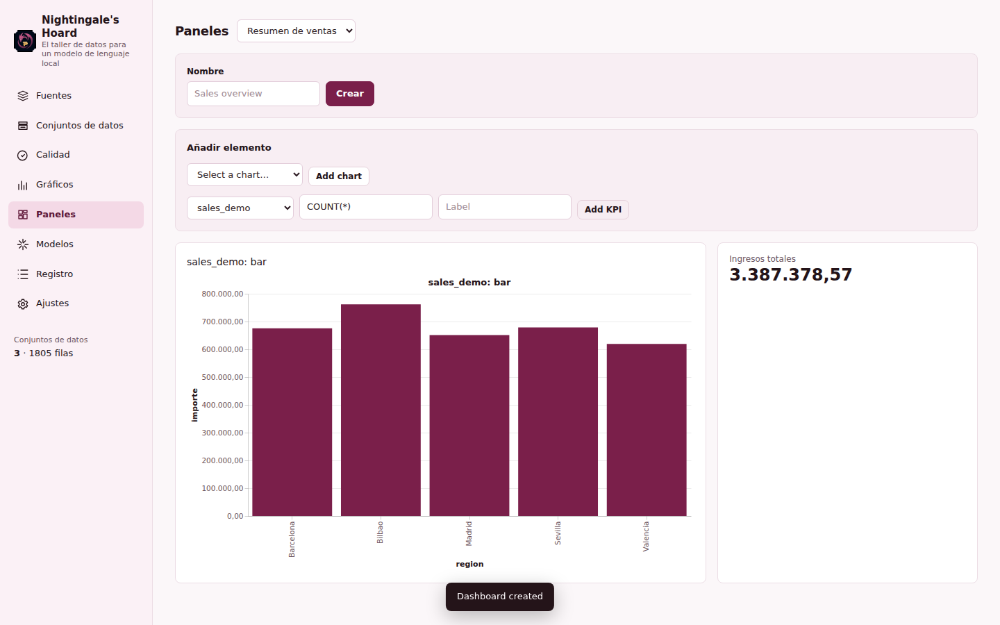

## Qué es

Nightingale's Hoard es la aplicación de datos de la familia Hoard. Cargas un archivo sucio, lo limpias con pasos versionados que puedes deshacer, lo validas con reglas que defines, lo conviertes en gráficos y paneles, entrenas un modelo rápido y le haces preguntas en lenguaje natural. Un asistente puede hacer todo esto por MCP exactamente igual que tú en el navegador.

Todo se queda en tu máquina: DuckDB guarda los datos y SQLite los metadatos (fuentes, versiones, reglas de calidad, gráficos, paneles, modelos y el registro de análisis). No hay cuentas ni llamadas de red salvo a la URL de archivo que le des.

Limpiar un conjunto de datos real suele ser un camino sin vuelta. Aquí cada paso crea una versión nueva y materializada, así que deshacer es instantáneo y un paso que no te gustó nunca tocó la versión anterior. Si el archivo de origen cambia, actualizar lo vuelve a ingerir y reproduce toda la receta sobre los datos nuevos, deteniéndose limpiamente si un paso ya no se puede aplicar.

La app incluye además dos módulos activables, Datos y Cálculo. Ambos están desactivados en una instalación nueva; activa solo lo que necesites desde Funciones. Cálculo (aritmética exacta, matemática simbólica, unidades, fechas, estadística, SQL sobre archivos) funciona sin cargar el banco de datos ni DuckDB.

## Qué hace

### Ingesta
- CSV/TSV (incluidos los separados por punto y coma y con coma decimal), Excel, Parquet, JSON/NDJSON, SQLite, un patrón de carpeta, una URL o texto pegado.
- Registros que devuelve otra app Hoard (a través del Hoard Hub), aplanados a una fila por registro, con preajustes como los movimientos de Ledger.
- Actualizar reingiere una fuente que cambió, reproduce la receta y ejecuta las reglas de calidad guardadas.
- Borrar un conjunto de datos arrastra sus reglas, gráficos y modelos, tras listar lo que depende de él.

### Limpieza y transformación
- 22 tipos de paso: filtrar, seleccionar, quitar, renombrar, convertir tipo, rellenar nulos, quitar duplicados, derivar, dividir columna, operaciones de texto, reemplazar, intervalos (por número o con límites explícitos), partes de fecha, agrupar (editor visual de agregaciones), pivotar, despivotar, unir, concatenar, ordenar, muestrear, ventana (lag/lead, sumas y medias móviles) y SQL directo.
- Todo paso se puede previsualizar antes de aplicarlo; aplicar crea una versión nueva.
- Deshacer, rehacer y un panel de receta desde el que se abre cualquier versión guardada; la receta se exporta como script SQL ejecutable.
- Uniones con pares de columnas exactos y comprobación de coincidencias antes de aplicar.
- Comparación de dos versiones por perfil de columnas o por filas (solo en A / solo en B, contando filas repetidas).
- Frecuencias por columna con recuentos y porcentajes exactos, paginadas.
- Rejilla de datos formateada según el tipo de columna y el idioma de la interfaz, con el valor original a un paso con el ratón.
- Exportación de una versión a CSV, JSON, Parquet o XLSX; exportación a una copia del libro original cambiando solo las celdas modificadas (una o varias hojas).

### Reglas de calidad
- Nueve tipos de regla: no nulo, único, valores aceptados, rango, expresión regular, número de filas, frescura, integridad referencial y SQL personalizado.
- Se ejecutan a demanda con historial de aciertos y fallos; una regla de unicidad fallida indica cuántos valores se repiten y cuántas filas quedarían tras eliminar duplicados.

### Gráficos y paneles
- 11 tipos de gráfico agregados en SQL, interactivos (Vega-Lite) y en PNG, con filtro de filas opcional y «usar como punto de partida» para copiar un gráfico guardado.
- Los paneles combinan gráficos guardados con indicadores definidos por expresiones SQL. Cada cambio es una acción tipada y reversible, con deshacer/rehacer e historial.
- Paneles como código: un archivo YAML sobre una capa semántica de métricas y dimensiones con nombre, con filtros, pestañas, bucles, condiciones y métricas derivadas; validado con pistas, versionado, comparable e importable/exportable.

### Modelos y Lab
- Aprendizaje supervisado con detección automática de la tarea y validación cruzada, k-means, PCA, detección de anomalías con isolation forest y previsión Holt-Winters. Los resultados van a un conjunto nuevo por defecto.
- Lab, una página aparte con siete pestañas (Explorar, Modelos, Diagnóstico, Optimizar, Comparar y deriva, Canalización, Informe):
  - EDA: correlaciones, patrones de nulos con vista previa de imputación, valores atípicos, sugerencias de codificación y una puntuación de calidad de 0 a 100.
  - Registro de modelos (lineal, ridge, logística, bosque aleatorio, gradient boosting, extra trees, k-NN, MLP, proceso gaussiano y, opcionalmente, XGBoost y LightGBM) con modelos versionados y persistentes.
  - Diagnósticos (residuos, predicho frente a real, calibración, ROC), ajuste de hiperparámetros, explicaciones SHAP o por permutación, optimización bayesiana y frentes de Pareto.
  - Detección de deriva, comparación de curvas, informe PDF y editor visual de canalizaciones que comparte el motor de pasos de Conjuntos de datos.
- Las librerías opcionales (Optuna, SHAP, XGBoost, LightGBM) tienen alternativas documentadas si faltan. Véase [docs/LAB.md](docs/LAB.md).

### Relato con los datos
- Convierte un conjunto de datos en una lista ordenada de hallazgos (tendencia, diferencia entre grupos, atípicos, concentración, cambio entre periodos), cada uno con su gráfico, una frase con la cifra exacta y la consulta que lo produce. Los hallazgos que no superan su umbral estadístico se descartan.
- Los hallazgos se pueden reordenar, quitar y editar; un modelo de lenguaje solo puede reformular una frase si no aparece ningún número nuevo.
- Se exporta como un único HTML autónomo o, a través del Hub, como presentación construida por Cicero's Hoard.

### Pregunta a tus datos
- Una pregunta en lenguaje natural se convierte en una consulta SQL visible, ejecutada con un modelo de lenguaje local compartido (Faustus, llama.cpp, Ollama o un endpoint compatible con OpenAI). Si no hay ninguno configurado, lo dice.

### Herramientas de análisis
- **Conciliar**: compara dos conjuntos fila a fila por pares de columnas clave, con claves sugeridas, tolerancias y normalización; cada fila y celda se clasifica y el resultado se puede guardar o descargar.
- **Libros de Excel como cálculo**: compila un `.xlsx` en un cálculo ejecutable, lo ejecuta con valores nuevos, traza resultados, contrasta con los valores guardados por Excel, recalcula en Excel o LibreOffice y exporta un módulo Python autónomo o una pequeña calculadora web local. Véanse [docs/WORKBOOK-COMPILER.es.md](docs/WORKBOOK-COMPILER.es.md) y [docs/WORKBOOK-EXPORT.es.md](docs/WORKBOOK-EXPORT.es.md).
- **Escenarios**: simulación de eventos discretos con semilla de una operación (llegadas, estaciones, turnos, colas, costes, existencias) con réplicas, intervalos al 95 %, comparación de variantes y barridos de parámetros.
- **Migrar**: ensaya una migración a tablas destino tipadas, con filas rechazadas y su motivo, idempotencia de la segunda carga, pruebas de ida y vuelta, totales y consultas funcionales, y DDL y archivo SQLite descargables.
- **Proceso**: descubre un proceso a partir de un registro de eventos (grafo de sucesión directa, variantes, retrabajo, cuello de botella, carga por recurso), comprueba la conformidad con un proceso de referencia y ensaya cambios frente a la línea base.
- **Presupuestos de fabricación**: presupuestos con unidades a partir de parámetros con nombre y partidas con fórmula, calibrados con trabajos pasados y comparados por escenarios.
- **Experimentos**: ajusta un modelo dinámico interpretable de una serie temporal (gemelo); diseña y analiza experimentos factoriales, de composición central e hipercubos latinos; estima el efecto de un cambio (diferencias en diferencias, series temporales interrumpidas y otros) con ajuste por grafo causal y pruebas de refutación.

### Módulo de cálculo
- Aritmética exacta, matemática simbólica, unidades, fechas, estadística, SQL sobre archivos, gráficos e historial de cálculo, independientes del banco de datos. Véase [docs/FUSION.md](docs/FUSION.md).

### Registro de análisis
- Cada operación recibe un id como `N-000123` con su entrada, un resumen de una línea, la duración y si la ejecutaste tú o el asistente. Es un rastro de auditoría de solo añadir, no una copia de seguridad de los datos.

## Cómo ejecutarlo

Requiere Python 3.11+ y Node 22+ (Node solo para compilar el cliente).

```bash
python -m venv venv
venv/bin/pip install -r requirements.txt      # Windows: venv\Scripts\pip install -r requirements.txt
venv/bin/pip install -r requirements-lab.txt  # opcional: Optuna, SHAP, XGBoost, LightGBM
npm install
npm run build
venv/bin/python -m nightingale --demo         # Windows: venv\Scripts\python -m nightingale --demo
```

Abre http://127.0.0.1:5189 y activa Datos o Cálculo en Funciones. `--demo` crea tres conjuntos inventados en una carpeta aparte `data-demo/`; quítalo para un banco limpio.

- `python scripts/launch.py` arranca la app en un puerto libre y abre el navegador.
- `python scripts/dev.py` ejecuta uvicorn con recarga y el servidor de desarrollo de Vite.

| Variable | Por defecto | Significado |
| --- | --- | --- |
| `NIGHTINGALE_PORT` / `PORT` | `5189` | Puerto preferido; `PORT_STRICT=1` lo fija, si no se usa el primero libre a partir de ahí. |
| `NIGHTINGALE_DATA_DIR` | `<repo>/data` (`data-demo` con `--demo`) | Archivo DuckDB, SQLite de metadatos, `mcp-token`, exportaciones, imágenes de gráficos. |
| `NIGHTINGALE_ALLOWED_HOSTS` | | Nombres de host extra aceptados detrás de un túnel. |

El servidor escucha en `127.0.0.1` y solo responde a `localhost`, `127.0.0.1` y `[::1]`. Para acceder desde el móvil por un túnel, lista los nombres de host en `NIGHTINGALE_ALLOWED_HOSTS` (separados por comas, exactos o `*.sufijo`, p. ej. `mi-pc.example,*.ts.net`); el `Origin` de las llamadas a la API también debe coincidir. Abierta por el túnel, el navegador ofrece instalarla como PWA.

## Conexión con Faustus y el Hoard Hub

- `faustus-plugin.json` es el manifiesto del plugin; cárgalo en Faustus para descubrir el catálogo MCP. Arranca la app desde el Hoard Hub y activa el módulo que necesites.
- El puente MCP (`mcp_server.py`) llama a la API HTTP de la app en marcha, igual que la interfaz del navegador, y nunca abre la base de datos. Las llamadas de agente usan el token Bearer de `<carpeta de datos>/mcp-token` (`GET /api/agent/tools`, `POST /api/agent/call`).
- Herramientas por grupos: fuentes e ingesta, conjuntos y perfilado, transformaciones, versiones y receta, consultas SQL, calidad, gráficos, paneles (normales y como código), modelos, exportación, relato, libros, conciliación, escenarios, migración, proceso, experimentos, registro de análisis y control de módulos. Referencia de las herramientas de Datos: [docs/MCP.md](docs/MCP.md); herramientas de Cálculo: [fusion/laplace-docs/MCP.md](fusion/laplace-docs/MCP.md). Donde los nombres coinciden, las de Cálculo llevan el prefijo `laplace_`.
- Al asistente se le indica que previsualice una transformación antes de aplicarla, que nunca suponga el nombre de un conjunto y que cite el id del registro de análisis al informar de un resultado.
- Un botón «Faustus» abre dentro de la app el panel de asistente común de la familia. Lleva como contexto el conjunto, panel, modelo de Lab o entrada de registro en pantalla y refresca las listas tras cada turno.
- La app lleva skills de la biblioteca de la familia para los agentes conectados (limpieza de datos con linaje, mejora medida, bucle de verificación, relato desde datos), disponibles con las herramientas de skills y como prompts.
- Otros documentos: [docs/API.md](docs/API.md), [docs/TRANSFORM-OPERATIONS.es.md](docs/TRANSFORM-OPERATIONS.es.md), [docs/DASHBOARD-ACTIONS.md](docs/DASHBOARD-ACTIONS.md), [docs/DASHBOARDS_AS_CODE.md](docs/DASHBOARDS_AS_CODE.md).

## Pantallas

<details>
<summary>Capturas</summary>

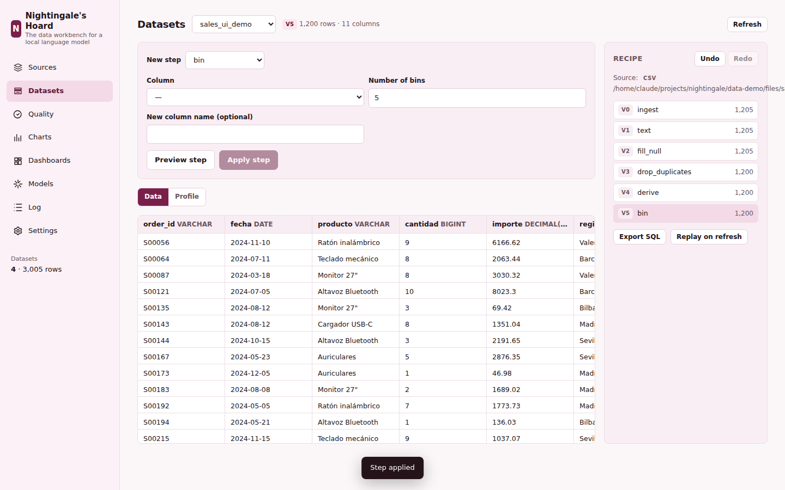 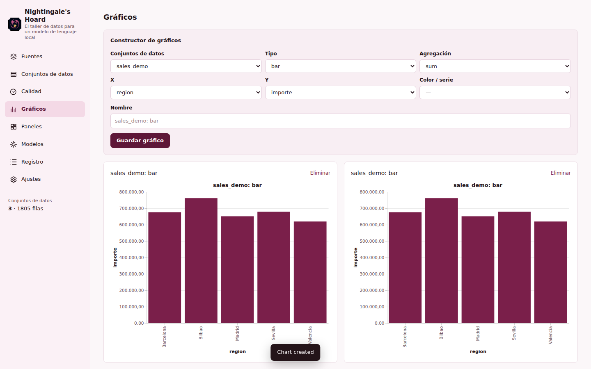
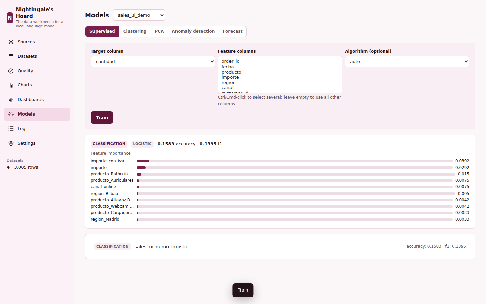 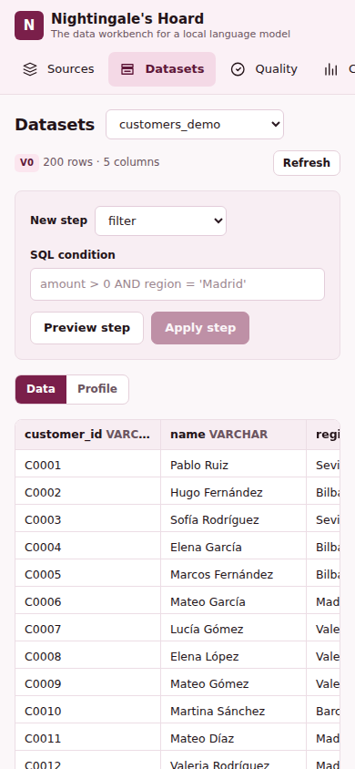
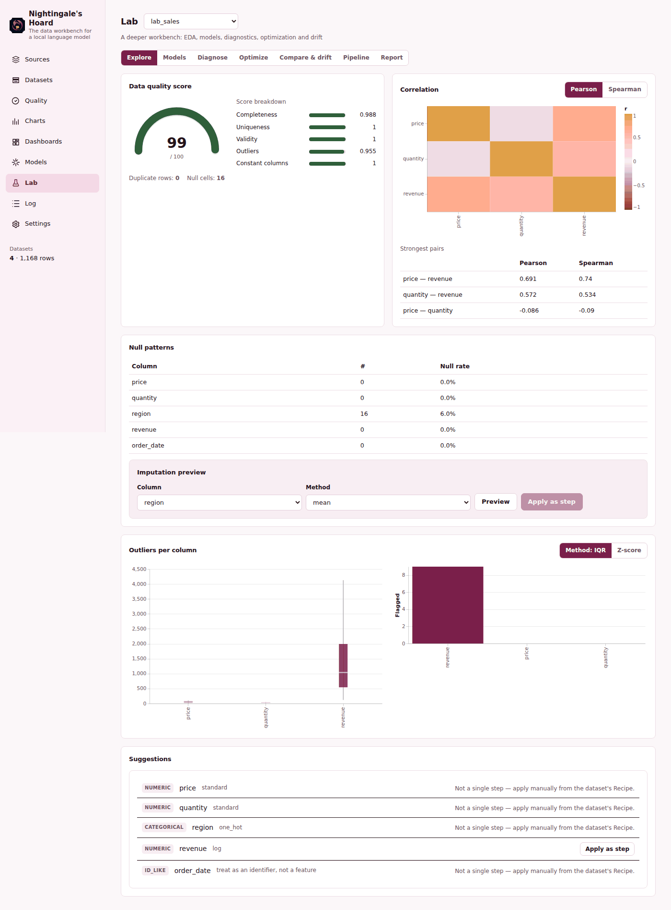 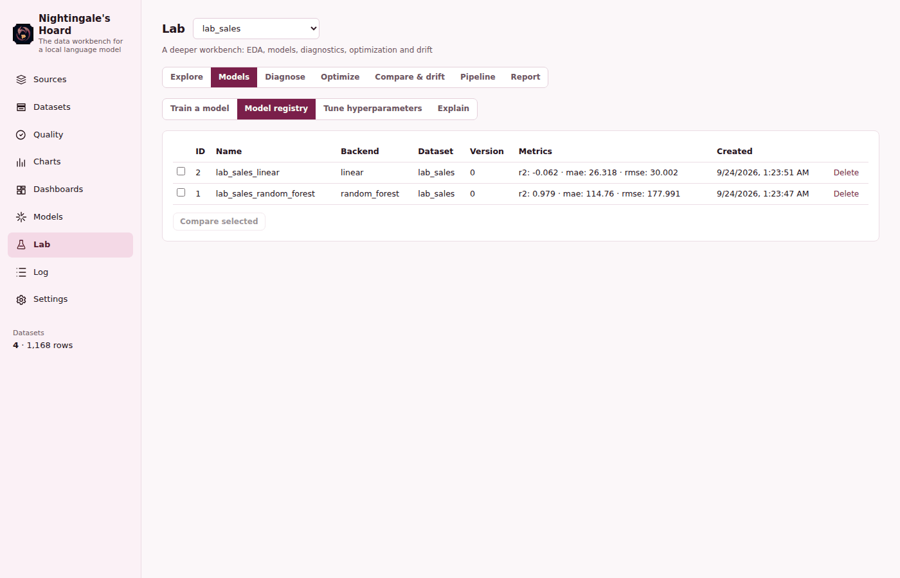
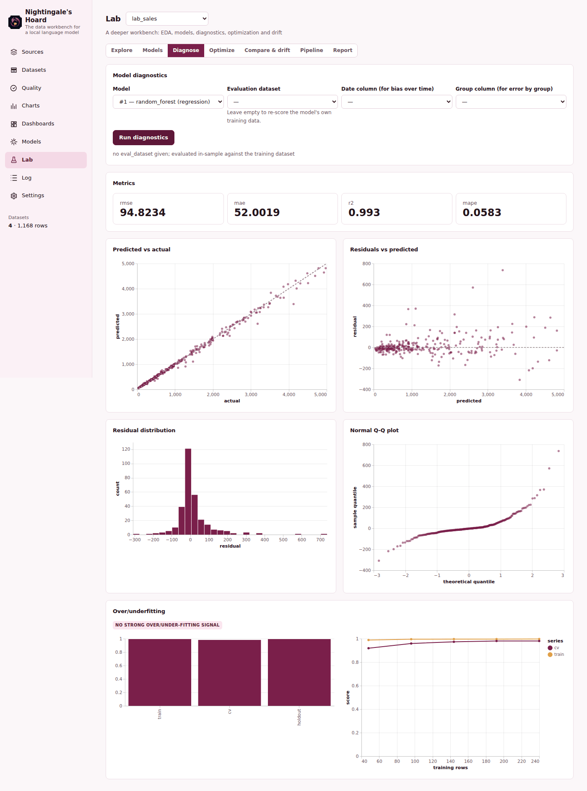 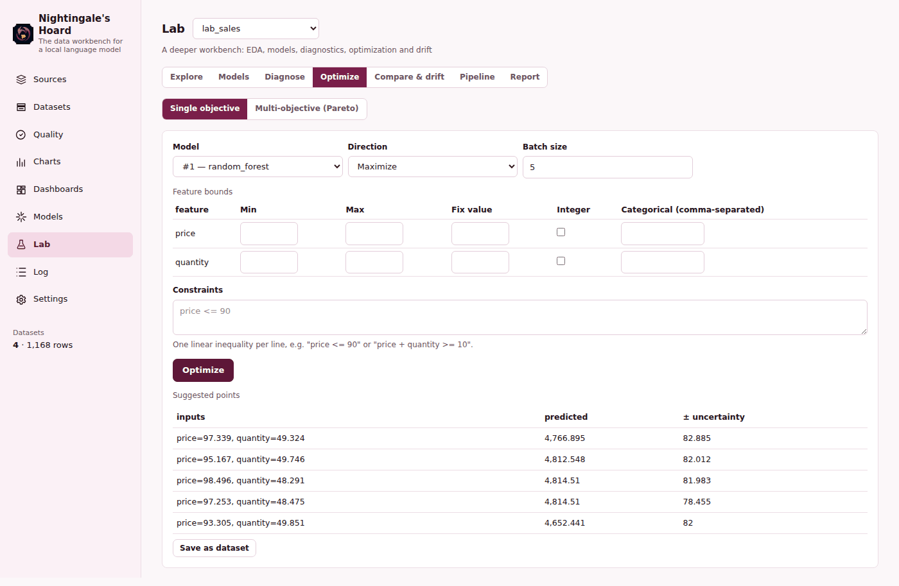
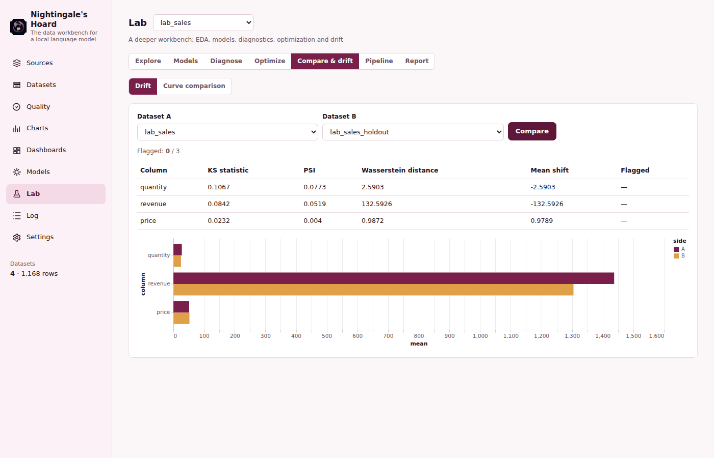 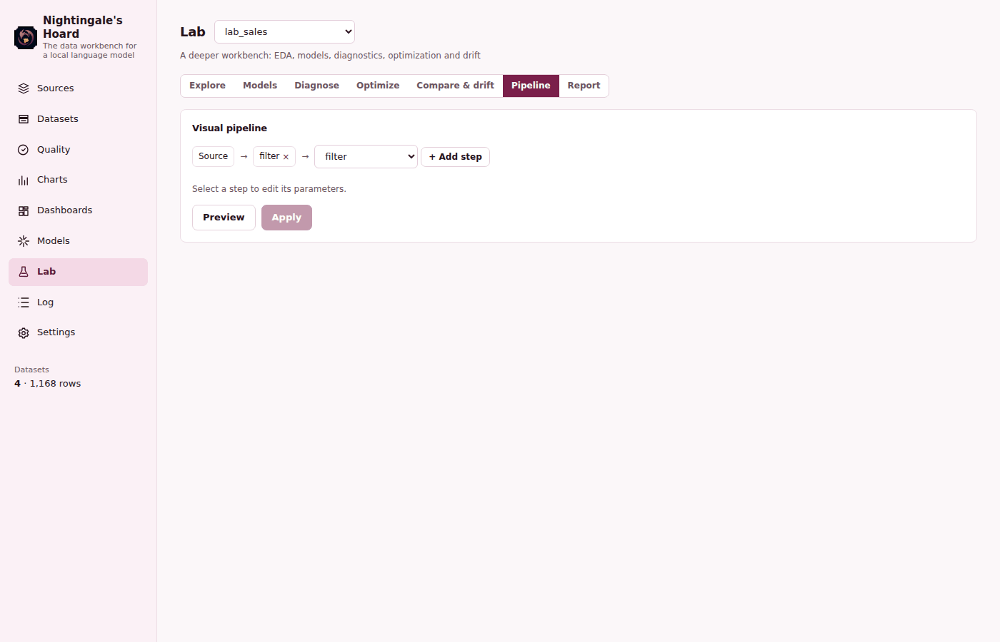
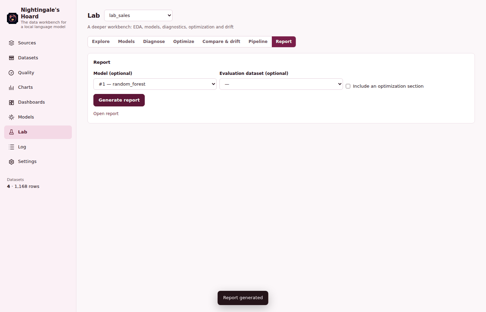 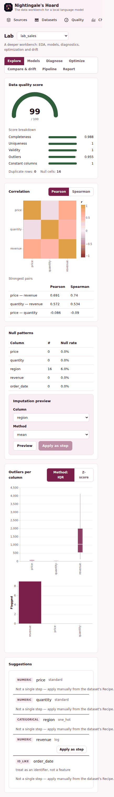 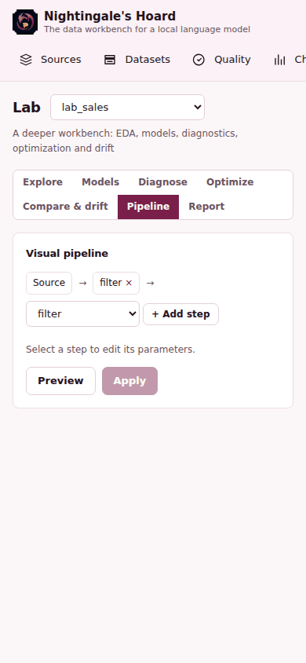

</details>

## Estructura del proyecto

| Ruta | Contenido |
| --- | --- |
| `nightingale/` | Paquete Python: API, motor del banco, Lab, paneles como código, relato, escenarios, minería de procesos y el resto de herramientas |
| `client/` | Interfaz React/Vite |
| `fusion/` | Módulo de cálculo y su documentación |
| `mcp_server.py` | Puente MCP por stdio |
| `faustus-plugin.json` | Manifiesto del plugin de Faustus |
| `scripts/` | `launch.py`, `dev.py` |
| `tests/` | Pruebas |
| `docs/` | Documentación de referencia y capturas |
| `data/` | Datos locales (se crea al ejecutar) |

## Desarrollo

```bash
venv/bin/python -m pytest -q     # Windows: venv\Scripts\python -m pytest -q
```

Los datos viven en `NIGHTINGALE_DATA_DIR`. Licencia: MIT, Luis María Salete Cuartero.
