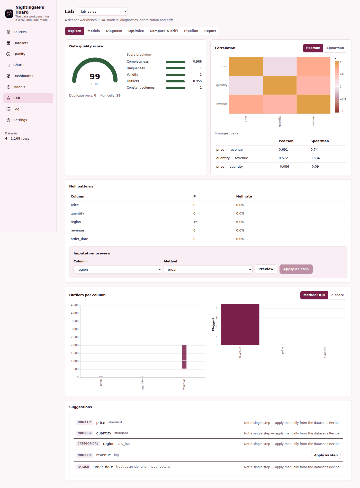
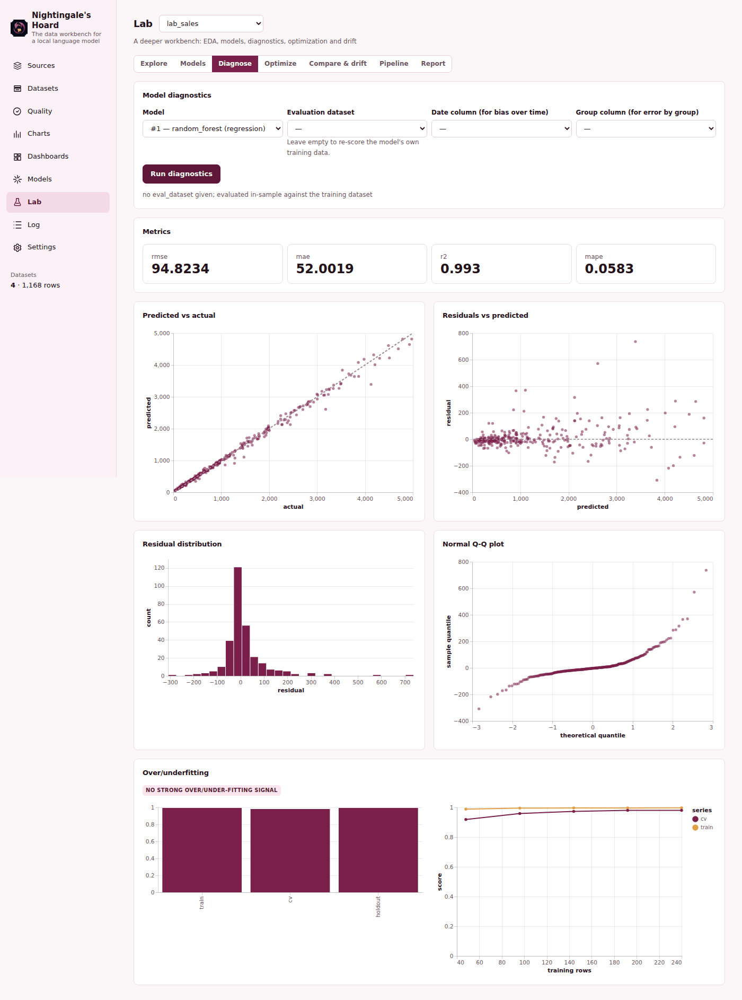

# Nightingale's Hoard

The shared **bin** editor in Datasets → Recipe and Lab → Pipeline accepts optional
JSON **Interval edges** and **Interval labels**. Non-empty edges override the bin
count and create native `[lower, upper)` intervals; the final upper edge, values
outside the intervals and NULL stay uncategorised. Missing labels use generated
interval text, while an explicit empty label stays empty. Blank edges or `[]`
keep the existing bin-count mode. Editing a saved step retains both arrays,
including zero edges and labels containing commas, quotes or Unicode. Preview
creates no dataset version; Recipe preview creates no analysis log, while Pipeline
records its normal dry run. Apply uses normal native version and recipe behavior.
Recipe preview shows up to eight rows. No frontend binning,
new validation, API or MCP tool is added; the combined catalogue remains43.

Datasets → **Column frequencies** reads every distinct value of a selected column
in the displayed saved version, with exact counts and percentages over all rows.
NULL and empty text stay distinct; full DuckDB text values are not truncated.
Load more reads the next native page; a failed page keeps the preceding rows for
Retry. Changing the column/version or closing the section clears incompatible
results. Reading creates no dataset version, analysis-log entry or output file.
`GET /api/datasets/{name}/frequencies` and `data_profile(mode="frequencies",
column=..., version=..., offset=..., limit=...)` share this calculation. Only this
new mode returns complete pages so its next offset cannot skip trimmed groups;
other profile modes keep their existing output behavior. The combined catalog
remains43tools. Values use DuckDB VARCHAR representation, not original binary
bytes; percentages are rounded in the UI. The selected query and applied page
metadata reach the normal Faustus context when the section is open.

The shared **window** step editor in Datasets and Lab → Pipeline now exposes
**Offset (rows)** for `lag`/`lead` and **Window size** for rolling sums/means.
Blank inputs keep native defaults of 1/3; explicit values, including zero, survive
editing a saved step and changing its output name. Function-specific controls
hide without discarding either stored parameter. Preview/apply use the existing
`data_transform` engine and API/MCP43, with no frontend calculation. Rolling
windows include the current row, start partially at partition boundaries and
count rows rather than calendar days. All-equal ordering keys do not determine
stable row positions. Native NULL/error and version/recipe behavior are unchanged.

Data → Recipe lets you choose the other dataset and add exact column pairs for a join; the same editor works in Pipeline. Manual JSON is retained, including comma, quote and Unicode column names or names from earlier pipeline steps. Native left, inner, right and full join types remain available. Check matches counts current saved left rows with at least one match in the current saved right version. It creates no version or analysis-log entry. Duplicate right keys can multiply joined rows; Preview shows that actual result. Coverage does not describe pending pipeline nodes. The existing API and new MCP `data_join_preview` share the native calculation; the combined catalog has 43 tools (21 Data, 20 Calculation and two controls).

The Charts constructor supports an optional **Row filter** using the native SQL
condition accepted by `data_chart` and `POST /api/charts`. Write a condition without
`WHERE`, using columns from the selected dataset; it selects input rows before
aggregation and does not transform the dataset. An empty field is omitted. SQL
errors keep the filter and chart draft for correction. Each rendered saved card
shows the filter from its persisted specification, or explicitly No filter; PNG
and interactive views use that same native specification against the current
dataset version. The complete filter is also included in the Faustus draft.
This extends the existing chart flow, with no new parser, tool or dependency.
Definitions follow [DuckDB's WHERE documentation](https://duckdb.org/docs/lts/sql/query_syntax/where).

Charts → **Download PNG** retrieves the selected saved chart through the existing
`GET /api/charts/{id}?image=true&lang=en` renderer. Each card identifies its chart,
dataset and requested interface language; a failed request can be retried without
changing the chart constructor draft. Download started means the file was handed
to the browser, not that a browser save was confirmed. The PNG reads the dataset's
current version when requested, uses the native chart query limits and may differ
from the interactive Vega view. It is neither a historical snapshot nor an export
of every dataset row. Downloading creates no chart, dataset version or analysis-log entry.

MCP `data_chart` also accepts `action="get", chart_id=<saved id>, image=true,
lang="en"|"es"`. Its PNG is returned as complete `image/png` ImageContent, with
JSON metadata separately capped and without a duplicate base64 field. `image=false`
returns metadata only. Omitting `action` retains the existing create behavior and
its existing response limits. The combined catalog remains 43 tools.

Datasets → **Export data** downloads every row of the displayed version as CSV,
JSON, Parquet or a single-sheet XLSX. The request captures the version explicitly
and uses the existing native `data_export` writer through
`POST /api/export/download`. The source and saved versions stay unchanged; export
files and the normal analysis-log entry are created. Flat XLSX does not preserve
the source workbook, and these files are not a project backup.

**Preserve original workbook (.xlsx)** is a separate dataset action. It shows the
recorded source, sheet/range, imported shape, sheet names and source fingerprint
match, then downloads a copy with only the selected dataset/version's sheet
patched by the existing native workbook exporter (`POST /api/export/workbook/download`).
The original file, datasets and saved versions stay unchanged; native receipts and
analysis-log entries are written normally. This requires a compatible imported
`.xlsx` with the same shape. It does not overwrite formulas or recalculate formulas
or charts; validation metadata is retained, not enforced. It is not a project
backup or a promise of complete Excel fidelity. Multi-sheet updates remain
available through the existing API/MCP `data_export` contract.

The dataset recipe panel opens any saved version using the existing undo/redo operations. Earlier steps are clickable, and later versions remain selectable until a new transformation replaces that branch. Export SQL now includes copy and `.sql` download actions in English and Spanish. The script uses local dataset tables; it is not a self-contained data backup. UI, API and MCP `data_undo`/`data_recipe` share the existing native calculation; the combined catalog remains 43 tools.

## Native data and calculation modules

Nightingale incorporates all of Laplace's arithmetic, symbolic math, units, dates, statistics, SQL-over-files, charts and calculation history. Data and Calculation are independent switches, both OFF on first installation or migration. Start the app explicitly from Hoard Hub, then enable only what you need. Calculation works without loading the data workbench or DuckDB. Full native interfaces live under `/data/` and `/calculation/`; one server owns both.

The static MCP catalog contains 40 native tools plus two module controls. Existing Nightingale tools retain their names; the three collisions are `laplace_data_list`, `laplace_data_query` and `laplace_data_chart`. Existing native data directories can be adopted in place through `data/modules.json` without copies or format changes. See [architecture and provenance](docs/FUSION.md).


The data workbench for a local language model: ingest a messy file, clean it with versioned steps
you can undo, check it against rules you define, chart and dashboard it, train a quick model, and
ask it a question — all on your own machine, and all reachable by an assistant through MCP exactly
the way you'd use it yourself.

Everything stays local: DuckDB for the data, SQLite for metadata (sources, versions, quality rules,
charts, dashboards, models, the analysis log), no accounts, no network calls except to a file URL
you gave it.

Part of the Hoard family (see `faustus-plugin.json`). Calculation preserves Laplace's read-only file catalog alongside Nightingale's reversible workbench.

## Why this exists

Cleaning a real dataset is normally a one-way trip: you overwrite the file, or you keep five
half-named copies "just in case." Nightingale keeps the trip reversible. Every cleaning step —
filter, rename, cast a type, fill a null, derive a column, join two datasets, twenty-one kinds in
total — creates a new, real, materialized version. Undo is instant. A step you didn't like never
touched the version before it. And if the *source file* changes later, "refresh" re-ingests it and
replays your whole recipe on the fresh data automatically, stopping cleanly if a step no longer
applies.

## What's implemented

| Feature | What it does | Boundaries |
| --- | --- | --- |
| **Ingest** | CSV/TSV (incl. semicolon-delimited, comma-decimal Spanish formats), Excel, Parquet, JSON/NDJSON, SQLite, a folder glob, a URL, or pasted text. | A single ingest call runs in a background thread with a 5-minute cap; very large files should be Parquet or pre-filtered CSV rather than a 50-sheet Excel workbook. Ingesting under a name that is already taken is refused (and the existing dataset left untouched): use refresh to reload it or pick another name. |
| **From the family** | Ingest source kind `hoard`: the records another Hoard app returns from one of its tools, called through Hoard Hub (`family.call`), with the list of records found in the answer (or given as `list_path`), flattened to one row per record (nested objects become `a_b` columns, lists JSON text) and ingested like JSON. Presets: `ledger_transactions` (Ledger `list_entries`, 200 per call up to 5000 entries, amounts in cents), `phileas_shipments` (Phileas `shipments_list` delivered, epoch times become timestamps and `transit_days` is added: calendar days from shipped to delivered), `argus_app_time` (Argus `screen_app_time`: **unverified**, that app was not available to check the tool name or its answer shape). In the UI: Sources, **From the family** (Desde la familia). Through MCP: `data_ingest` with `kind="hoard"` and `preset` or `app` + `tool` (+ `args`, `list_path`, options `paginate`, `max_rows`, `epoch_columns`, `derive`). | Needs the hub and the other app running; with either missing the error says which. Running the same hoard ingest again under the same name adds a NEW VERSION (`ingest`) on top of the current one, so Undo returns to the previous snapshot and cleaning steps are not replayed; `data_refresh` instead rebuilds from the app and replays the recipe. A different app/tool under a taken name is refused like any ingest. Pagination only for tools with limit/offset arguments; a capped import says `truncated`. |
| **Transform** | 22 step kinds (filter, select, drop, rename, cast, fill_null, drop_duplicates, derive, split_column, text ops, replace, bin, date_parts, group, pivot, unpivot, join, union, sort, sample, window, raw SQL) — every one previewable before it's applied. `GET /api/transforms` documents each parameter contract; add a dataset for current column names/types, version, and row count. | The `sql` step and the SQL query tool both accept exactly one read-only statement; no writes, no multi-statement scripts. See [transform parameters](docs/TRANSFORM-OPERATIONS.md). |
| **Compare rows** | The Rows view compares saved versions using selected columns of identical name/type. Counts preserve repeated rows and NULL; independently paged Only A / Only B tables show exact native differences. `data_rows_compare` and `POST /api/datasets/{name}/versions/rows` use the same engine. | Omitted columns and their reasons are explicit; this compares projected row multisets, without matching edited rows by guessed identity. Display cells use the existing 500-character preview limit; counts use complete native values. |
| **Compare versions** | From Datasets or the recipe panel, compare two saved versions: row/column counts, added/removed/type-changed columns, nulls, approximate distinct counts and min/max. Also available as `data_versions_compare` and `GET /api/datasets/{name}/versions/compare?version_a=0&version_b=1`. | Compares column profiles by name; does not match individual rows or cells. Differences are B minus A; comparison does not move the current version. |
| **Undo / redo / recipe** | Every version is a real table; a side panel shows the full recipe, exports it as a runnable SQL script, and can replay it against re-ingested source data. | Branching after an undo discards the redone-away versions (like any editor's undo stack) — there's one timeline, not a tree. |
| **Quality rules** | 9 rule kinds (not_null, unique, accepted_values, range, regex, row_count, freshness, referential integrity, custom SQL), run on demand, with a pass/fail history. A failed `unique` rule says how many values repeat, how many rows are extra copies, and how many rows would remain after de-duplication. | Rules check the dataset's *current* version; they don't run automatically on ingest unless you re-run them yourself. |
| **Charts & dashboards** | 11 chart kinds, aggregated in SQL (never a full table pulled client-side), rendered interactively (Vega-Lite) and as PNG (for export/agent use); dashboards combine saved charts with SQL-expression KPI tiles. | Charts read the dataset's current version at render time — a chart doesn't freeze past data, it reflects the latest cleaning. |
| **Reversible dashboard edits** | Every change to an item-based dashboard (add/remove/move an item, change a KPI query or a chart, retitle, rename, filter, grid columns) is one typed action with a JSON schema, applied by a single reducer, written to a per-dashboard action log and invertible. The Dashboards page (buttons, undo/redo, change history) and the MCP tool use the same code path; dashboards saved before this get stable item ids and an initial-state snapshot the first time they load. See `docs/DASHBOARD-ACTIONS.md`. | A new action discards the undone (redo) branch; item references (chart id, dataset) are checked when an item is added or changed, not on undo. |
| **Dashboards as code** | A dashboard as a plain YAML file over a reusable semantic layer (named metrics/dimensions per dataset) — filters, tabs, rows of metric/chart/table/text widgets, `for` loops over top-N dimension values, `if` conditions, and derived metrics (e.g. a metric shifted a month back). Validated with a `hint` on every issue, rendered with each widget's own SQL and error (one bad widget never breaks the rest), kept in a 20-version history with diffs, and exportable into the item-based dashboards above. See `docs/DASHBOARDS_AS_CODE.md`. | Everything compiles to read-only SQL over a dataset's own view, same trust level as a chart filter. |
| **Models** | Supervised learning (auto task detection, cross-validation, feature importance, confusion matrix), k-means clustering (elbow + silhouette), PCA, isolation-forest anomaly detection, Holt-Winters forecasting with interval and a documented seasonal-naive fallback. A "Write results to" control (new dataset by default, with a one-line explanation of the alternative) chooses where predictions/labels/flags land: `new_dataset` (default) puts them in their own new dataset (`<source>__model_<id>` etc.), the source dataset untouched; `new_version` writes onto the source itself instead, and even then only ever adds a column; `none` just shows the result. Every copied source column — in either destination — keeps its exact DuckDB type (a DATE stays a DATE, a DECIMAL stays a DECIMAL); only the new prediction/label columns are computed in pandas. | Training samples down at 200k rows; automatic feature selection excludes near-unique identifier-like columns (reported back) to avoid a one-hot blow-up — pass an explicit feature list to override. |
| **Delete a dataset** | Removes a dataset, all its versions, and cascades to its quality rules, charts, and models; a dashboard that used one of those charts keeps working (it shows the item as unavailable) rather than breaking. Available from the Datasets screen (with a confirmation dialog listing what depends on it), `DELETE /api/datasets/{name}` (`?force=true` to go past dependents), and the `data_ingest` MCP tool's `action="delete"`. | Blocked by default when charts/dashboards/models depend on the dataset — pass `force`/`force=true` to delete anyway. |
| **Analysis log** | Every operation (ingest, transform, quality run, chart, model, export...) gets an id like `N-000123`, with input, a one-line summary, timing, and whether it came from you or the assistant. | The log is append-only and capped per-field in size; it's an audit trail, not a full data backup. |
| **Ask your data** | A plain-language question becomes one SQL query (shown, not hidden) run through a shared local language model via Hoard Link. | Needs a resolved LLM backend (Faustus, a local llama.cpp server, Ollama, or an OpenAI-compatible endpoint) — with none configured it says so clearly instead of guessing. |
| **Lab** | Deeper data science on top of the workbench, with its own page (seven tabs — Explore, Models, Diagnose, Optimize, Compare & drift, Pipeline, Report): full EDA (correlation, null patterns + imputation preview, IQR/z-score outliers, encoding suggestions with one-click apply-as-step) and a 0-100 quality score (only ever shows 100 when every component is actually perfect); a pluggable model registry (linear/ridge/logistic, random forest, gradient boosting, extra trees, k-NN, MLP, Gaussian process, plus XGBoost/LightGBM if installed) with versioned, persisted models; model diagnostics (residuals, predicted-vs-actual, error by group, bias over time, over/under-fitting, calibration, and for classifiers a plotted ROC curve — one-vs-rest per class when there are more than two); hyperparameter tuning (Optuna TPE or a randomized fallback); explanations (SHAP or permutation importance + partial dependence); Bayesian optimization of a model's inputs (GP surrogate + EI/UCB) and multi-objective Pareto fronts; drift detection and curve/series comparison between datasets; a PDF report; and a visual pipeline editor (add/reorder/edit/preview steps as a node chain, applied through the same step engine as the Datasets page). See `docs/LAB.md`. Datasets and Models each link straight into it ("Open in Lab" / "Open in Lab registry"). | XGBoost/LightGBM/Optuna/SHAP are optional (`requirements-lab.txt`) — every feature degrades to a documented fallback without them. |

For an imported `.xlsx`, workbook-preserving export can write changed dataset cells into a copy
of the original workbook while retaining unchanged cells and workbook features. One request can
update several imported tabs in that copy. It includes a source inventory and lineage receipt;
formulas cannot be overwritten, and validation rules are preserved but not enforced. See the
[workbook export guide](docs/WORKBOOK-EXPORT.md) for the API, MCP, and supported boundaries.

The data grid formats every cell by its DuckDB column type and the UI's own language setting —
dates and timestamps render as dates (a timestamp at exact midnight drops its time-of-day), and
numbers get thousands separators and sensible precision (2 decimals for `DECIMAL` columns, up to 4
significant digits for other numeric types) — while the exact raw value stays one hover away (a
tooltip) and a double-click away (copies it to the clipboard).

### Lab, in the UI

 

## Use cases

- Drop in a messy CSV a colleague sent you, watch the workbench guess types and encodings, clean it
  with a handful of steps, and export something you'd actually hand to someone else.
- Ask an assistant to "look at this data and tell me what's off" — it can profile, run quality
  checks, and cite the exact `N-000123` log entry for whatever it found.
- Keep a recipe against a source file that updates weekly: refresh re-applies every step to the new
  data in one call, runs saved quality rules, and reports failing rules with sample rows. Pass
  `check_quality=false` to skip the checks for a particular refresh.
- Train a same-afternoon model on a dataset you just finished cleaning, without leaving the app or
  writing a notebook.

## Quick start

Requires Python 3.11+ and Node 22+ (Node only to build the client).

```bash
git clone <this repo> nightingale-hoard
cd nightingale-hoard
python -m venv venv
venv/bin/pip install -r requirements.txt      # Windows: venv\Scripts\pip install -r requirements.txt
venv/bin/pip install -r requirements-lab.txt  # optional: Optuna/SHAP/XGBoost/LightGBM for the Lab package
npm install
npm run build
venv/bin/python -m nightingale --demo         # Windows: venv\Scripts\python -m nightingale --demo
```

Open http://127.0.0.1:5189 and enable Data or Calculation in Functions. `--demo` seeds three invented datasets in Data when enabled (a messy Spanish-format sales
CSV, a customer table, a seasonal sensor time series with a few injected anomalies) into a separate
`data-demo/` folder, so it never touches real data. Drop `--demo` for a clean workbench.

- `python scripts/launch.py` starts the app on a free port and opens the browser.
- `python scripts/dev.py` runs uvicorn with `--reload` plus the Vite dev server (proxying `/api`).

## Configuration (environment)

| Variable | Default | Meaning |
| --- | --- | --- |
| `NIGHTINGALE_PORT` / `PORT` | `5189` | Preferred port; `PORT_STRICT=1` pins it, otherwise the first free port from there. |
| `NIGHTINGALE_DATA_DIR` | `<repo>/data` (`data-demo` with `--demo`) | DuckDB file, metadata SQLite, `mcp-token`, exports, chart images. |
| `NIGHTINGALE_ALLOWED_HOSTS` | | Extra host names accepted behind a tunnel (see below). |

### Access from your phone (behind a tunnel)

The server binds `127.0.0.1` and only answers requests whose `Host` is `localhost`, `127.0.0.1` or
`[::1]`. To reach it from your phone through a tunnel, list the extra host names in
`NIGHTINGALE_ALLOWED_HOSTS`, comma-separated, exact names or `*.suffix`:
`NIGHTINGALE_ALLOWED_HOSTS=my-pc.example,*.ts.net`. Port and letter case are ignored, and the
`Origin` of API calls must resolve to one of those hosts too. Once opened through the tunnel, the
browser offers to install it as a PWA.

## Connect to Faustus

Load `faustus-plugin.json` in Faustus to discover the static MCP catalog. Start the app explicitly
from Hoard Hub and enable the requested module. The bridge calls the running app's HTTP API,
the same as the browser UI, and never opens the database itself.

## API

All JSON; errors are `{ "error": "..." }`.

- `GET /api/health`, `GET /api/status`
- `GET /api/sources`, `POST /api/sources/ingest` (`kind: "hoard"` with `preset` or `app` + `tool` + `args` + `list_path`), `GET /api/sources/hoard-presets`
- `GET /api/datasets`, `POST /api/datasets/{name}/refresh`, `DELETE /api/datasets/{name}`, `GET /api/datasets/{name}/dependents`
- `GET /api/datasets/{name}/{profile,preview,lineage,recipe,correlation}`
- `POST /api/datasets/{name}/{transform,undo,redo,join-preview}`
- `POST /api/query`
- `GET/POST /api/datasets/{name}/quality`, `POST /api/datasets/{name}/quality/run`, `DELETE /api/quality/{id}`
- `GET/POST /api/charts`, `GET/DELETE /api/charts/{id}`
- `GET/POST /api/dashboards`, `GET /api/dashboards/{id}`, `POST /api/dashboards/{id}/items`\n- `GET /api/dashboards/action-schemas`, `POST /api/dashboards/{id}/{actions,undo,redo}`, `GET /api/dashboards/{id}/history` - typed, reversible edits (`docs/DASHBOARD-ACTIONS.md`)
- `GET/PUT /api/dac/semantic`, `POST /api/dac/semantic/validate`, `GET /api/dac/semantic/suggest?dataset=`
- `GET/POST /api/dac/dashboards`, `GET/PUT/DELETE /api/dac/dashboards/{slug}`, `POST /api/dac/dashboards/{slug}/{rename,validate,render,export}`, `GET /api/dac/dashboards/{slug}/{history,diff}`, `POST /api/dac/dashboards/import` — see `docs/DASHBOARDS_AS_CODE.md`
- `POST /api/models/{train,cluster,pca,anomaly,forecast}`, `GET /api/models`
- `POST /api/export`
- `GET /api/log`, `GET /api/log/{id}`
- `POST /api/ask`, `GET /api/ask/available`
- `GET /api/agent/tools` (catalog + instructions), `POST /api/agent/call` (Bearer token from `<DATA_DIR>/mcp-token`)

## MCP tools

See `docs/MCP.md` for the Data module reference (29 tools, `data_ingest` through `data_ask`) and a minimal
walk-through. The shipped instructions tell the assistant to preview a transform before applying it
when the effect isn't obviously safe, to never assume a dataset name (`data_list` first), and to
cite the analysis-log id (`N-000123`) when reporting a result back. Calculation adds 20 native tools
documented in [its reference](fusion/laplace-docs/MCP.md); three collisions use the `laplace_`
prefix listed above. `nightingale_modules` and `nightingale_set_module` complete the 51-tool catalog (29 Data, 20 Calculation, 2 controls).

## Tests

```bash
venv/bin/python -m pytest -q     # Windows: venv\Scripts\python -m pytest -q
```

Tests cover the workbench engine (every ingestion path, every transform step, versioning and
undo/redo/replay), quality rules, charts and dashboards, models (including the id-like-column
exclusion, the duplicate-timestamp forecasting fix, and that both the default new-dataset output
and the `write_to="new_version"` opt-in preserve every copied column's exact type), dataset
deletion (dependents check, cascade, force), the HTTP API, agent tools through `/api/agent/call`,
the request guard, the PWA endpoints, and a subprocess end-to-end test through the MCP stdio
bridge.

## License

MIT — Luis María Salete Cuartero.


## Shared services (HoardLink 0.8.1)

URL imports use the shared Web client and the Hub catalogue bridge. Import and analysis behavior remains in the app.

The vendored copy is maintained by HoardLink’s sync script. Windows validation and the family service contract are documented in HoardLink’s `docs/commons/windows-validation.md` and `docs/commons/services.md`.

## Faustus panel

A «Faustus» button opens the family's shared assistant panel without leaving the app. Faustus keeps the conversations
(also listed in Faustus Studio), runs the agent with the globally selected model and uses this app's own tools. Each turn
carries the dataset, dashboard, dashboard-as-code, Lab model or log entry on screen; unsaved YAML of a dashboard-as-code or the semantic layer, and the new-chart and new-rule forms. After a turn the lists and the open view refresh in place, without discarding what you were typing. The
panel comes from Hoard Link (`install_spa`) and talks to Faustus through this app's relay, so no token reaches the browser.


## Owned data and compatibility

Native module data can be relocated into `data/native/<module>/data`, with per-module configuration beside it. Writer fiction uses the owning desktop profile `writers-hoard/fiction/data`. Move complete data trees, including SQLite WAL/SHM, media, downloaded models and browser sessions; update saved absolute paths before enabling a module. The compatibility manifests in `compatibility/<id>/faustus-plugin.json` preserve native IDs, tool schemas and tokens without a retired checkout. Add each merged application's `compatibility` directory to Hub roots before the general repository root. Discovery and compatibility bridges never start an application. All modules remain OFF during relocation.

Legacy in-place adoption scripts are optional import helpers; keeping the old repository is unnecessary once relocation and route updates have been verified.

## Aggregation editor

Dataset steps and Lab → Pipeline share a visual `group` editor: select grouping
columns, add/remove metric rows, choose a function and column, and optionally name
each result. Column names containing commas, spaces or Unicode remain complete
names. No grouping columns sends `group_by: []` for a global summary.

All existing native functions are available: `sum`, `avg`, `min`, `max`, `count`,
`count_distinct`, `median`, `stddev`. Count without a column means `COUNT(*)`;
column counts and distinct counts ignore NULL. `stddev` is sample standard
deviation. Values are calculated by the existing dataset engine, not JavaScript.

The manual aggregation JSON remains visible and updates the row controls when its
shape is representable. Invalid text and other JSON shapes remain editable without
being replaced. Grouping columns also accept a JSON array or the existing comma
list; use JSON for column names containing commas and for intermediate pipeline
columns. Existing node parameters round-trip without splitting names.

Editing invalidates the previous preview. Preview creates no dataset version;
the existing explicit Apply does. In Lab, Save updates the node's parameters and
Preview uses those saved parameters. These forms use the existing transform and
pipeline APIs and `data_transform` MCP capability; the 43-tool catalog is unchanged.

## Reuse a chart's settings

In Charts, **Use as a starting point** loads a saved chart's dataset, kind, axes, aggregation, color, row filter and title into the editable builder. It identifies the original chart and focuses the title. Loading the form saves nothing; **Save chart** creates another chart ID and preserves the original. Fields remain after saving or an error, including later edits made while saving. List refreshes do not reapply the starting settings. This uses the existing chart get/create API and `data_chart` MCP actions; all43 tools remain unchanged. It uses current dataset rows and does not duplicate data, historical pixels, dashboards or analysis history.

## Excel workbooks as calculations

Compile an `.xlsx` into an executable calculation (parameters, lookup tables, results), run it with new values, trace a result to its inputs, check it against Excel's saved values, recalculate seeded new cases in Excel or LibreOffice and export a standalone Python module. Unsupported formulas are frozen with Excel's value and listed. Page **Workbooks**, API `/api/sheets/*`, agent tool `data_workbook`. It also explains the calculation: a sensitivity ranking (tornado) of the numeric parameters for any output, named scenarios saved with the workbook and compared against the base, and unit checking (declared units plus currency and percent number formats, propagated through the formulas with Pint, reporting unit errors such as metres plus euros). These are extra actions of `data_workbook`, are logged, and the tool count is unchanged. Details: `docs/WORKBOOK-COMPILER.md`.

Corrections 2006 retain the 1900/1904 date system throughout evaluation and export, preserve literal text beginning with = and report empty verification as inconclusive. All 38 workbook tests pass, including real Excel recalculation for both epochs; the reviewed corrections are installed (2006 submission 2, merge 3e322c0).

**Export calculator** also produces a single Python file containing the calculation and a local web form. The recipient needs Python 3 with its standard library; Nightingale, Excel and an LLM are unnecessary. Typed parameters, dates, errors and frozen-result notices are preserved. Native API and MCP share this export (`data_workbook`, `action="export"`, `format="app"`). Ten additional export tests pass, including running the generated server with `python -I -S`. Export 2011 submission 2 is reviewed and installed (merge c6781c2), together with corrections 2006; see the workbook compiler guide for usage and limits.

## Reconciling two datasets

Compare two datasets row by row on one or more key column pairs (for example a CRM export against the ERP). Nightingale suggests key and value column pairs from name similarity and value overlap, then classifies every row as paired, only left, only right, ambiguous (duplicate key) or missing key, and every compared cell as equal, equal within tolerance, different, zero vs missing, empty vs missing or one-sided. Normalisation options: trim, case-insensitive, numeric comparison, empty as missing and a numeric tolerance. Every count comes with samples and a plain explanation; the row-level result can be saved as a new dataset or downloaded as CSV. Page **Reconcile**, API `/api/reconcile/*` (`suggest`, `run`, `export.csv`), agent tool `data_reconcile`. Every run is written to the analysis log.

## Scenario lab

Describe an operation as a model (arrivals by Poisson rate, hourly schedule or measured inter-arrival times; stations with servers, shifts, buffers and service-time distributions; costs; an optional stock item with reorder point and lead time) and simulate it with a seeded discrete-event engine. Each run uses several replications and reports mean and 95% interval for throughput, lead time (mean, median, p90), waiting, utilisation and queue per station, WIP, lost jobs, stockouts and cost, plus a Little's-law check and, for a single M/M/c station, the Erlang-C waiting time next to the simulated one. Named variants are compared with common random numbers and each difference is marked distinguishable or not; a sweep varies one parameter over a list of values. Calibration reads durations or timestamps from a dataset column, reports the sample size and warns when it is small. The output is a set of scenarios under stated assumptions, not a prediction. Models are saved by name; results can be saved as datasets. Page **Scenarios**, API `/api/scenarios/*`, agent tool `data_scenario`. Every run is written to the analysis log.

## Migration rehearsal

Rehearse a migration before the real one. A spec (JSON, saved by name) lists target tables, each with a source dataset or read-only SQL over datasets, typed columns (`INTEGER`, `REAL`, `TEXT`, `DATE`, `BOOLEAN`) with a required flag, a DuckDB expression over the source columns (default: the same-name column) and a kind (`representation` or `correction`), plus primary, unique and foreign keys and checks. A rehearsal rebuilds one SQLite file per migration name under the data directory and loads the tables parents first. Per table it reports source rows = loaded + rejected, with every rejected row and its reason (value that does not convert, with column and raw value; missing required value; repeated primary or unique key; foreign key without a parent); rejected rows can be saved as a dataset. A second load upserts by primary key into the same file and the report shows counts and a content hash unchanged and no duplicate keys. Representation columns are tested by round trip against the source column and flagged when they change a value; correction columns report how many values they changed. Total checks (source expression against a target column, with tolerance) and functional queries (a source query and a target query whose results must match) are evaluated on both sides. The target DDL and the SQLite file can be downloaded. A suggestion helper drafts a table from a dataset profile and says it is only a draft. Source datasets are never modified. Page **Migrate**, API `/api/migrate/*` (`suggest`, `specs`, `rehearse`, `ddl`, `ddl.sql`, `file/{name}`), agent tool `data_migrate`. Every run is written to the analysis log.

## Process discovery and change rehearsal

Load an event log (one row per event: case id, activity, timestamp, optionally the step's start, a resource and a cost; columns are suggested from names and values). **Discovery** gives the directly-follows graph with frequencies and median/p90 waiting time, filtered with the heuristic-miner dependency measure (a threshold and a minimum count; length-two rework loops are kept), variants with counts and shares, start and end activities, rework loops, throughput times per case, the bottleneck (where waiting time concentrates) and the workload per resource. Without a start column the time before a step mixes waiting and working, and the result says so. **Conformance** checks every case against a reference process given as ordered steps (with optional and parallel markers) or as allowed transitions, and reports skipped, inserted, repeated and reordered steps with counts, shares and example cases. **Rehearsal** turns the discovered process into a model for the scenario lab engine (empirical durations per step, routing shares from the graph, resource pools, arrival rate), first checks that the baseline reproduces the observed throughput time and says when it does not, and then compares changes (add resources, remove a step, change a routing share, shorten a duration) with the baseline using common random numbers and 95% intervals; the model can be stored in the Scenarios page. Results can be saved as datasets. Page **Process** (process map with a frequency/duration toggle, variants, bottlenecks, conformance, rehearsal), API `/api/process/*` (`suggest`, `discover`, `conform`, `rehearse`), agent tool `data_process`. Every run is written to the analysis log. Limits: routing is first-order (a step's successor depends only on the step), durations are drawn independently, shared resources are modelled as one pool per step, and capacity can only be estimated when a start column exists. **Event-log profile and holdout calibration** (`nightingale/event_log.py`): the mapping also accepts a `lifecycle` column (one row per `start`/`complete` event, paired per case and activity) instead of a start column, and `log_options` declare the time zone of timestamps without an offset (offsets that are written are kept; everything is normalised to UTC), end activities (cases that do not reach one are open/censored: counted and listed, kept out of times and fitting) and the expected sequence (missing steps per closed case). Loading is deterministic (timestamp, then lifecycle, then source row; equal completion times are ties whose order is not inferred) and every event keeps its source row; exact duplicates, unreadable or impossible timestamps (including local times that do not exist in the declared zone), completions without a start, starts without a completion, ambiguous local times and cases whose UTC offset changes are separated and listed. The **profile** gives variants, the directly-follows graph with frequencies, coverage and the edges that depend on ties or overlapping intervals, observed times with sample size and p10–p95, service time and waiting separated where start times exist (elsewhere: elapsed time, waiting plus work, with the missing data named), concurrency between overlapping steps, where work accumulates (average cases waiting) and an explainable list of deviations; a directly-follows count is not presented as causality. **Calibrate** fits a scenario-lab model on the cases that start before a temporal split (every parameter with its source events, sample size and estimator, or marked not identifiable with the data that is missing), simulates it with the existing engine and checks it against the held-out cases with explicit tolerances; a failure is shown as such, and alternatives (another operator, another printer…) are compared with the same seeds and replications (95% intervals). **Export** returns the profile and recipe as JSON with a reference to the dataset (name, version, content fingerprint), never its rows; a recipe can be re-run and warns if the data changed. CSV import accepts `text_columns` to keep a timestamp column as written so its offsets survive. **Editing the proposal**: `model_edits` (`arrival_rate`, `stations.<activity>.{service, servers}`, `routing.{start, next}`) is validated with explicit messages (non-positive rates or capacities, unknown activities, shares that are negative or add up to zero, distributions with impossible parameters), applied on top of the fitted model, marked per parameter as edited by the user with the fitted value and its source kept, and the holdout validation and alternatives are re-run with the edited model (same seeds and replications) together with the difference against the fitted model; the edits travel in the recipe. **Start/complete pairing**: rows of the same case and activity are paired by resource first when a resource column is mapped (the earliest open start with the same resource), otherwise first in, first out; the profile reports per activity how many pairs each rule decided, how many overlapped and how many differ from FIFO. A timestamp column that was already imported as timezone-aware is detected and the profile says the written offsets are gone and that the file must be imported again with `text_columns`. Actions `profile`, `calibrate`, `export` on `data_process`, API `/api/process/profile|calibrate|export`, tabs **Event log profile** and **Calibration** on the Process page. The dataset is never modified.
## Experiments

One page, three tabs, backed by `/api/twin/*`, `/api/experiment/*`, `/api/effect/*` and the agent tools `data_twin`, `data_experiment`, `data_effect`. Every run is written to the analysis log.

**Twin.** From a regularly sampled time series (a time column, outputs and inputs) Nightingale fits an interpretable linear dynamic model by least squares: a multi-output ARX model (a linear state-space model in companion form; its poles and steady-state gains are reported) or, for one input and one output, a first-order-plus-dead-time step-response model. The lag order is chosen on a selection block that is kept apart from the held-out last part of the record, which is then scored by one-step and free-run NRMSE (RMSE over the range of the observed values), R2 and a persistence baseline. The residual check (Ljung-Box and the 95% band) says when dynamics are missing, and the empirical coverage of the prediction interval on the held-out block is reported. Parameters and gains carry residual-bootstrap intervals. What-if simulations take an input profile (held value, list, step or ramp) and return the response with an interval (coefficient uncertainty plus resampled residuals) next to a baseline with the inputs held. Inputs outside the range seen in training are flagged; far outside (default more than 25% of the range) the twin refuses unless told to proceed. Twins are saved by name. Limits: linear dynamics only, uniform sampling (the longest regular stretch is used), the interval excludes structural error and process changes, and the horizon is warned about when it exceeds the validated block.

**Design and next run.** Two-level full and fractional factorial designs (generators, defining relation, resolution, alias structure), central composite designs (face, inscribed or circumscribed) and seeded maximin Latin hypercubes, with bounds and forbidden combinations written as expressions or boxes; what a restriction costs (loss of balance, estimable terms) is reported. Results are analysed into main effects, interactions and, when the design allows, a quadratic surface with confidence intervals; an unreplicated saturated design is judged with Lenth's pseudo standard error rather than an invented error estimate, and curvature, lack of fit and the stationary point (flagged when outside the region) are checked. The next run is the candidate with the largest prediction variance, or with the best expected improvement for a maximise or minimise objective, and the answer states why. For discrete hypotheses (for example three possible causes) with a predicted outcome per test, tests are ranked by information gain per cost, the cheapest test that separates all hypotheses is named and a sequential plan is shown. The recommendations assume the fitted model form; the hypothesis ranking is only as good as the stated probabilities and costs.

**Effect of a change.** Difference-in-differences with a control group (cluster-robust errors when a unit column is given, parallel pre-trend test with the bias it would imply, placebo date), interrupted time series (segmented regression with pre-trend, level change and slope change, optional seasonality, AR(1) errors when residuals are autocorrelated, linearity check of the pre-period, placebo dates) and regression adjustment for listed confounders (naive versus adjusted estimate, balance, propensity overlap, stability as confounders are added, a robustness value against an unmeasured confounder, optional placebo outcome). Each assumption is listed as passed, failed or not testable; a failed one turns the verdict into a warning, and the result never claims causation. Placebo and pre-trend tests have limited power with short series.
